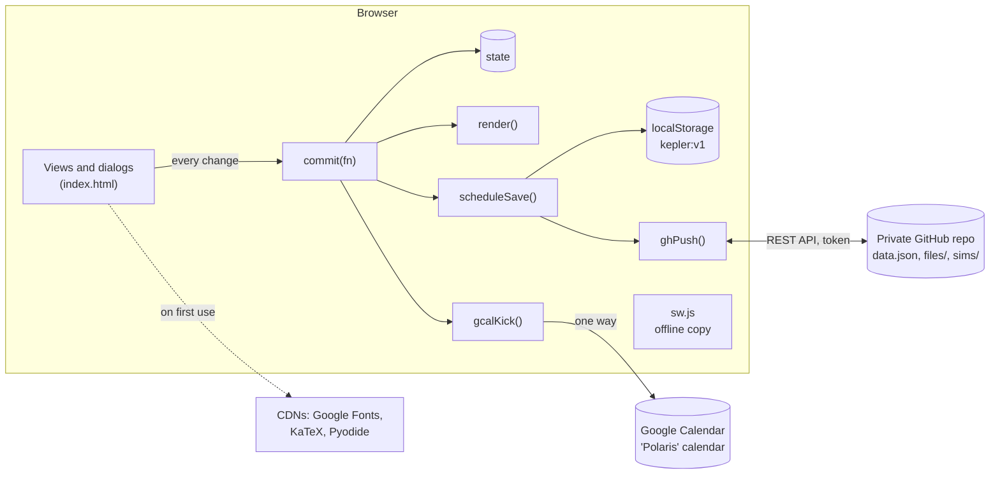
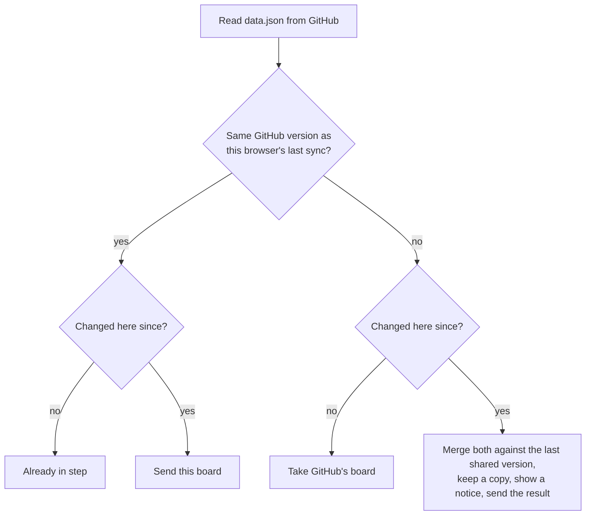

# Polaris Handbook

Checked and updated on 28 Nov 2026. This file is for the owner and for any AI helping later. It contains no personal data, so it can live in the public app repo (for example as `HANDBOOK.md`, `AGENTS.md` or `CLAUDE.md`).

**Contents**

1. [Start here](#1-start-here)
2. [Files and where they live](#2-files-and-where-they-live)
3. [How the code is organized](#3-how-the-code-is-organized)
4. [Data model](#4-data-model)
5. [Features, tab by tab](#5-features-tab-by-tab)
6. [Saving and sync](#6-saving-and-sync)
7. [Performance](#7-performance)
8. [Health check, Nov 2026](#8-health-check-nov-2026)
9. [Troubleshooting](#9-troubleshooting)
10. [Changing Polaris safely](#10-changing-polaris-safely)

---

## 1. Start here

Polaris is a one-person planner for research, applications and classes. It is a single web page, `index.html`, and it keeps its data in a private GitHub repo. To change it, edit that one file in place, keep it as one file, and follow the rules below.

**What it is**

- Tabs: To-do (today's list), Timeline (projects as lines across a week), Compass (personal rules) and Research (stages, a notebook, reading cards with notes and sims). There is also a project window and a Library of tables.
- It runs entirely in the browser. There is no server, no build step, no framework and no npm package. It installs as an app (a PWA) and works offline.
- Data is saved in the browser on every change and synced to a private GitHub repo (`polaris-data`), using a token the owner pastes in. Uploaded files and sims live in that repo too.
- There is one user, the owner. Nothing is shared and there are no accounts.

**Rules that never bend**

1. `data.json` never goes in the public app repo. Personal data lives only in the private data repo and in the browser.
2. The public files hold no personal content. That means no names of mentors or other people, no research specifics and no project or mission details. Any built-in sample text stays generic. Run the privacy check before every release (section 10).
3. Google Calendar sync is one-way. Polaris writes events and never reads or imports anything from the calendar.
4. The To-do list stays separate from Compass and Research. They share no items and no links.
5. Sims and uploaded HTML, SVG or XML files never run as Polaris pages. They open in a new tab inside a sandboxed frame without `allow-same-origin`, so they can't reach Polaris storage or the GitHub token.
6. Simple beats clever: no clutter, no counts or badges nobody needs, and no repeated text. Controls stay hidden until they're needed (icons on hover, "+ Add" links that open a small form).
7. The app ships as one file named exactly `index.html`.

**How an AI should work on it**

- Read sections 3 and 4 before editing anything.
- Every new saved field must also be added to `normalize()` (or to `normThesis()` for Research). Otherwise it is silently dropped on the next load.
- Change saved data only through `commit(fn)`, or through `thQuiet(fn)` while the owner is typing. Views are rebuilt from `state`, so never treat the page as the data.
- Escape every user string with `esc()` before it goes into HTML. Markdown goes through `mdToHtml()`, which is already safe.
- Test in a real browser with the console open, at laptop and phone width, and run `polaris-smoke-test.py`. Then run the privacy check.
- Keep the owner's style: plain words, short labels, and fewer controls rather than more. Ask before adding a feature.

---

## 2. Files and where they live

| File | What it is | Where it lives |
|---|---|---|
| `index.html` | The whole app: CSS, HTML template and one script (about 553 KB, or 155 KB gzipped) | Public app repo, served by GitHub Pages |
| `sw.js` | The offline helper (service worker), which caches the app | Public app repo, next to `index.html` |
| `manifest.webmanifest` | App name, colors and icons for installing | Public app repo |
| `icon-192.png`, `icon-512.png`, `icon-maskable-512.png` | App icons | Public app repo |
| `polaris-smoke-test.py` | Automated check of every tab with a fake GitHub (no personal data) | Public app repo (optional) |
| `POLARIS-HANDBOOK.md` | This handbook | Public app repo (optional) |
| `data.json` | The board: every project, task, note and setting | **Private** data repo only |
| `files/YYYY-MM/xxxxxx-name.ext` | Files attached to reading cards (up to 25 MB each) | **Private** data repo |
| `sims/<sim-name>/xxxxxx-name.ext` | Sim files (HTML, or Python and its data) | **Private** data repo |
| Browser storage | An offline copy of the board, the token and small settings (section 4) | Each browser |

**Deploying a change**

1. Commit the new `index.html` (and `sw.js` or the manifest if they changed) to the public repo.
2. GitHub Pages republishes it within about a minute at `https://<user>.github.io/<repo>/`.
3. Open the site and reload once. The offline helper fetches from the network first, so the new version appears straight away when online.
4. To undo a release, revert the commit in the public repo.

---

## 3. How the code is organized

Each change to the board runs `commit()`, which updates `state`, redraws the page and then saves. Saving writes a browser copy and a GitHub commit, and the calendar is updated a moment later.

**One file, three parts**

- CSS, inside `<style id="app-style">` (lines 10 to about 1500)
- An HTML shell, inside `<template id="app-shell">`, which is cloned into `#app` at start
- One script, inside `<script id="app-script">`: an IIFE written in plain ES5 style (`var` and `function`) with `'use strict'`

Line numbers drift as the file changes, so search for the section markers below instead.

| Search for | What's there | Key functions |
|---|---|---|
| `= constants =` | Icons, link types, `LS_KEY`, `TITLE_MAX` | `cleanUrl`, `linkInfo` |
| `= helpers =` | DOM, escaping, dates and time zones | `$`, `$$`, `esc`, `uid`, `addDays`, `zonedMs` |
| `= state =` | The `state` and `ui` objects, plus loading and migrating data | `normalize`, `loadLocal`, `sampleState` |
| `= saving =` | The change and save loop, and the status line | `commit`, `scheduleSave`, `trySave`, `setStatus`, `cacheLocal` |
| `= GitHub sync` | The GitHub API, files, merging and connecting | `ghGet`, `ghPut`, `ghPull`, `ghReconcile`, `ghMerge`, `merge3`, `ghPush`, `openSync` |
| `= rendering =` | Choosing a view, reminders, the Timeline and the Library | `render`, `renderReminders`, `renderBoard`, `renderTables` |
| `= to-do =` | Today's lists and Compass | `todoLists`, `renderTodo`, `renderCompass` |
| `= Thesis:` | Research: stages, `TH_TOOLS`, the notebook, Markdown, marks, cards, sims | `normThesis`, `renderThesis`, `renderThPage`, `mdToHtml`, `htmlToMd`, `thCardHTML` |
| `run a sim's Python` | The Pyodide worker and sealed HTML pages | `pyWorker`, `thRunSim`, `thOpenSealed` |
| `= drag to reorder =` | Dragging lists by pointer (hold to drag on phones) | `dragDown`, `applySort` |
| `= Google Calendar` | One-way calendar sync | `gcalSync`, `gcalWanted`, `openGcal` |
| `= modal =` | Dialogs | `openModal`, `closeModal`, `confirmDialog` and every `open…` dialog |
| `= project window =` | The project "hub" | `hubHTML`, `renderHub`, `openHub` |
| `= events =` | Wiring (runs once) | `mount` |
| `= boot =` | Start-up order | `start` |

**The core loop**

- `commit(fn)`: runs `fn(state)`, adds 1 to `state.rev`, then calls `render()`, `scheduleSave()` and `gcalKick()`.
- `thQuiet(fn)`: used while typing. It changes `state` with no redraw, then saves 500 ms after the last keystroke.
- `render()`: redraws the header, reminders, the quick-add bar and the current tab from `state` plus `ui`. It also runs `autoEndPass()`, which ends projects whose deadline has passed.
- `renderThPage()`: skips redrawing while the owner is typing in that page. It also skips when nothing changed, using a cache key from `thPageKey()`, and during drags (`ui.thDrag`).
- `mode` is one of `pending`, `local`, `github`, `artifact` or `readonly`. Only `local` and `github` are used now. The `artifact` and `window.claude` code is left over from when Polaris ran inside Claude. It's harmless, but don't build on it.

**Conventions**

- All user text goes into HTML through `esc()`. Markdown goes through `mdToHtml()`, which escapes everything and only allows `http(s)` links.
- Events use delegation. Containers get one listener each, set up once in `mount()`, `initThesis()`, `initDrag()` or `initCompass()`. Buttons carry `data-act="..."` plus `data-id`, `data-pid` or `data-k`.
- Dialogs use `openModal({ draw, onClick, onSubmit, onInput, onClose, wide })`. `confirmDialog({ title, body, yes, danger, onYes })` escapes the title, but **not the body**, so escape any user text you put in the body.
- The phone back button closes the top dialog or page through `layerOpen` and `layerClosed`, which add history entries.
- Small state that isn't saved lives in `ui` (open cards, folded groups, forms that are open).
- Files from the data repo that can run code (HTML, SVG, XML) open only through `thOpenSealed()`, never as a same-origin `blob:` page.

---

## 4. Data model

`data.json` is the board as one JSON object. `normalize()` defines its exact shape: it fixes types, applies limits and drops unknown fields. Strings are cut to the limits shown.

**Top level**

| Field | Meaning |
|---|---|
| `v` | Format version (2) |
| `rev` | Revision counter; goes up by 1 on every change |
| `title` | Board name (40) |
| `areas[]` | `{id, name}` project kinds: `research`, `application`, `class` |
| `mission` | `{title, goals[]}` (legacy; kept, not shown) |
| `projects[]` | Projects, below |
| `updates[]` | Timeline entries ("what I did"), below |
| `tasks[]` | Quick to-dos with no project, below |
| `compass[]` | `{id, stage, title(120), text(1500), from(80)}`; stage is `always`, `choose`, `gap`, `build`, `share` or `feedback` |
| `compassTests[]` | Idea checks: up to 15 strings, used by Topic candidates |
| `thesis` | Everything in Research, below |
| `reviewWeek` | Monday of the last weekly review |
| `dayOrder` | `{day, ids[]}`: today's manual order on To-do |
| `gcal` | `{clientId, calendarId}`: Google Calendar setup, shared by all devices |
| `kindsV` | Migration marker (3) |

**Project**: `id`, `name` (80), `color` (0 to 5; research is always 6), `start`, `ended` (a date or null), `endedBy` (`'deadline'` or null), `deadline` (a date), `deadlineAt` (the exact moment in ms, when a time was given), `deadlineTz`, `parked` (a date or null), `area`, `goal`, `pointsTotal`, `milestones[]`, `links[]`, `notes` (always empty; old notes became updates), `created`, `sample` and `rstage` (the research stage id). Only one research project can be running at a time.

**Milestone** (shown as a "task"; a "step" when it has a parent): `id`, `title` (300), `status` (`todo`, `doing`, `waiting` or `done`), `done`, `doneOn`, `doneAt`, `date`, `time`, `at`, `tz`, `today` (the date it was pulled onto today's list), `url`, `rule` (1500), `points`, `parent` (the id of its task) and `waitSince`.

**Update**: `id`, `projectId`, `date`, `text` (2000) and `created`. It also has `task` when it was made by ticking a milestone, and `piece` when it's about one task.

**Quick task**: `id`, `title` (300), `url`, `day`, `time`, `done`, `doneOn`, `doneAt` and `created`. Finished ones are deleted 30 days after being done.

**Project link** (files and links): `id`, `url`, `title` (120), `kind` (`link`, `file` or `published`), `notes` (5000) and `added`.

**Thesis (Research)**

| Field | Meaning |
|---|---|
| `title`, `question`, `advisor`, `due` | Shown in the Research header |
| `stage` | Current stage: `lit`, `topic`, `proposal`, `method`, `results`, `writing` or `defense` |
| `canvas` | `{forest, gap, leaf, method, scope, risks}`: the Research canvas (4000 each) |
| `pages[]` | Notebook pages and card notes, below (up to 3000) |
| `marks[]` | The Important page: `{id, page, text, created, q, pre, suf}` |
| `topics[]` | Topic candidates: `{id, title, status (exploring, chosen or dropped), checks[], notes, umb, created}` |
| `umbrellas[]` | Topic groups: `{id, name, created}` (4 at most in the UI) |
| `journal[]` | `{id, date, text (20000; a "# Title" first line names the entry), created, updated}` |
| `lists{}` | Stage lists keyed `stage.list`, below |
| `groups{}` | `{'lit.papers': [{id, name}]}`: reading-card groups (12 at most) |

**Page**: `id`, `title` (160), `kind` (`note` or `chat`), `source` (`claude`, `chatgpt` or empty), `stage`, `created`, `updated`, `parked`, `blocks[]` of `{role: you | ai | note, text}`, `proj` (the research project it belongs to), `card` (`'lit.papers|<cardId>'` for a reading card's note), `ord` and `pin` (a card note's order, and whether it's pinned; 2 pins per card at most), and `ann[]`. Each `ann` entry is a highlight: `{id, kind: yellow | red | tyellow | tred | strike | fade, q, pre, suf}`, found again in the text by the quoted words plus some text on each side.

**Stage lists** (`thesis.lists`): `proposal.sections`, `proposal.feedback`, `lit.papers` (reading cards, 20 at most), `method.chain`, `results.runs`, `writing.chapters`, `writing.feedback`, `defense.prep`, `defense.questions` and `sims.list`. Each item is `{id, title (300), status, f: {field: text}, created}`. Reading cards and sims also have `links[]`, where each entry is either a link `{u, n}` or a file `{f: repo path, n: name, s: size, t: type, sha}` (12 per card). Reading cards have `g` (their group), and sims have `p` (the reading card they belong to). `TH_TOOLS` in the code defines each list's statuses and fields.

**Browser storage keys**

| Key | Holds |
|---|---|
| `kepler:v1` | Offline copy of the board |
| `kepler:github` | `{repo, branch, path, token}`: the GitHub connection for this browser |
| `kepler:v1:sync` | `{sha, rev, repo, path}`: the GitHub version this browser last matched (used for merging) |
| `kepler:v1:view` | Last tab |
| `kepler:v1:dismissed` | Reminders dismissed in the last week |
| `kepler:v1:corrupt` | A saved copy that couldn't be read, kept untouched |
| `polaris:backup` | The board from before the last merge or replacement (one copy) |
| `polaris:th-page`, `polaris:th-src` | Last Research page; last chat source |
| `polaris:gcal-token`, `polaris:gcal-rev` | Google sign-in for this device (about 1 hour); last revision sent to the calendar |

---

## 5. Features, tab by tab

**Header**: the board name (editable), the tabs, the status line, and badges for GitHub (G) and Google Calendar (C). The C badge only shows once the calendar is set up. Also here are **+ New project** and the ⋯ menu (Library, Weekly review, Parking lot, Backup, and Google Calendar until it's set up).

**Reminders** (To-do only): deadlines and dated tasks due within 3 days, more than 3 tasks in Doing, more than 3 projects in orbit, tasks waiting for 7 days or more, projects with no update for 5 days, and a weekly recap (Monday to Wednesday). Two kinds show on every tab: a project that just reached its deadline, and notices about your data (a merge, a damaged copy, a full browser).

**To-do**: the add bar reads dates from the end of what you type ("call the office fri 3pm"). The chip under it shows what it understood, and × keeps the text as typed. A pasted link becomes the task's link. Sections: **Today** (overdue, due, pulled in with the sun button, and quick tasks; drag to reorder), finished items as faded stars for 48 hours, **This week** (the next 7 days) and **Next steps** (the first open task of each project with nothing scheduled). Research and parked projects stay off this tab.

**Timeline**: one week around today (Earlier, Today, Later). Each project is a line, and each update is a dot (a check mark when it came from ticking a task). Deadlines show as flags, dated tasks as diamonds, and ended projects stop at a red ✕ and leave the board 7 days later. The Parking lot is a divider; drag a project below it to park it. Tap a lane to log a day, and tap a dot to see or edit that day.

**Project window**: tasks with a status pill, steps inside tasks (drag to reorder), Activity (log what you did, optionally about one task), Files & links, and Archive (finished tasks). Application projects can show an exact rule per task. Application and class projects can show points per task and a scoring bar.

**Compass**: "Always" rules as big cards, then the stages in order. Tap a card to edit it.

**Research**

- **Header**: the research title and question, the 7 stages (tap one to view it, and use "Make this the current stage"), the running research project for that stage with its next task, and the **Journal** button.
- **Notebook** (left): + Paste a chat (it splits "You said / Claude said" into turns), + Note, and search (it also finds card notes and journal entries). There are pins for Important, the current stage's tool page, Sims and the Research canvas. Pages are grouped by stage, plus a Parking lot.
- **Page** (right): edit text and title in place. An edited block is turned back into Markdown and saved after a short pause, and redrawn when you leave it. Select text to get the pen bar: Important, yellow or red highlight, yellow or red text, strike, ghost and clear. Math is drawn with KaTeX when it can load; otherwise the TeX stays as text.
- **Stage tool pages**: Topic candidates (umbrellas, candidates and idea checks), Proposal sections and feedback, Reading cards, Method chain, Results log, Chapters and feedback, and Defense prep and questions.
- **Reading cards** (literature stage): groups start folded and cards can be dragged between groups. Each card has a status (To read or Read), **+ File** (links and uploads to the private repo), **+ Note** (several notes, each with a main idea; drag to reorder; pin up to 2) and **+ Sim**.
- **Sims**: a sim is a name plus a file. HTML sims open in a new tab inside a sealed frame. Python sims (`.py` plus data files) run in a Pyodide worker. The first run downloads about 12 MB, plus 10 to 15 MB more for numpy and matplotlib, and plots can be kept as files. The Sims library groups sims under their reading card.

**Library**: tables of projects (including archived ones), all files and links, and updates. The updates table shows the latest 300 with a "Show all" button; search always looks through all of them.

**Weekly review**: what got done last week, what's stuck, and picking this week's 3 tasks for Doing.

**Backup** (⋯ → Backup): copy or download the board as JSON, download copies kept in this browser, or restore by replacing the board with a file or pasted JSON.

**Google Calendar** (one-way): Polaris writes final deadlines and dated tasks into its own "Polaris" calendar, using the narrow scope `calendar.app.created`. Events are keyed by the item's id and tagged `polaris=1`. Polaris only deletes events that carry that tag. Setup needs a Google Cloud OAuth client ID (Web application) with the site's origin as an authorized JavaScript origin. Signing in is per device and lasts about an hour.

---

## 6. Saving and sync

**When things are saved**

- Every change runs `commit()`. The browser copy (`kepler:v1`) is written 300 ms after the last change, and again just before each GitHub save (without GitHub, it's written right away). It is also written immediately when the page is hidden or closed.
- GitHub gets one commit 1.5 s after the last change. The file is pretty-printed `data.json`, with a commit message like "Polaris: 3 projects, 5 updates".
- When the page is hidden, Polaris saves at once. When it becomes visible again, it pulls from GitHub. When the connection comes back, it saves anything waiting. After a network error or a GitHub outage it retries every minute.

**How this browser and GitHub stay in step**

- The sync record (`kepler:v1:sync`) stores the sha of the GitHub file this browser last matched, and the revision at that moment.
- **Merging** fetches the shared version from GitHub's history (`git/blobs/<sha>`) and merges three ways with `merge3()`. Lists of things with ids (projects, tasks, updates, pages, cards and so on) merge item by item. Something added on either side is kept. Something deleted on one side is deleted, unless the other side changed it. When both sides changed the same value, **this device's version wins**. Before applying a merge, the pre-merge board is saved to `polaris:backup`, and a notice offers to download it.
- **First sync** in a browser (no record yet): if GitHub's board is the same, nothing happens. If GitHub's revision is higher, Polaris takes it and keeps this browser's copy. Otherwise this browser's board is sent and GitHub's copy is kept. A notice explains which happened.
- **Connecting** a browser that already has its own different board asks which board to keep. The other one is kept as a copy.
- **A save that GitHub rejects as out of date** (409 or 422) re-reads the file and goes through the same steps, up to 3 times.

**What the status line shows**

| Status line | Meaning |
|---|---|
| (nothing) and a green G | Synced |
| **Offline · saved on this device** (orange) | No connection, or GitHub can't be reached. Changes are kept and sent later. |
| **Not synced · Fix** (red) | GitHub refused: an expired or mistyped token, a missing permission, or the repo or file was renamed. **Fix** opens the GitHub window with the reason. |
| (nothing) and a grey G | GitHub isn't set up: the board is saved in this browser only |

**Files and sims**

- Uploads go one at a time through the Contents API: 25 MB at most per file and 12 links or files per card. Uploading a file with the same name replaces the old file and deletes it from the repo.
- Files open in a new tab. PDFs, images, text, audio and video open as normal, and their memory is freed when that tab closes. HTML, SVG and XML open in a sealed frame. Other types download.
- GitHub limits (from GitHub's documentation): reading a file of 1 to 100 MB needs the "object" or "raw" media type, and files over 100 MB aren't supported. Polaris reads `data.json` with the object type and falls back to `git/blobs` above 1 MB. Files are read with the raw type.

**The GitHub token**

- Use a fine-grained personal access token for the data repo only, with **Contents: Read and write**.
- It is stored in this browser's localStorage, under `kepler:github`. Sims and uploaded HTML can't read it because they run sealed off.
- It can expire. When it does, the status line shows **Not synced · Fix** and changes wait safely in the browser (section 9 explains how to renew it).

**The offline helper (`sw.js`, cache `polaris-v2`)**

- The app loads network first. The saved copy is used only when offline, or when the network takes more than 4 s. Navigation preload starts fetching the page while the worker wakes up.
- One saved copy per file is stored, never one per query string. Fonts use a cached copy, refreshed in the background.
- Requests to GitHub, Google and CDNs are never cached by the helper. KaTeX and Pyodide stay in the normal browser cache after first use.
- If you change `sw.js`, bump `CACHE` (for example to `polaris-v3`). Old caches are deleted when the new worker starts.

**External code**

| What | When it loads | Pinned |
|---|---|---|
| Google Fonts (Unbounded, Geist, Geist Mono) | Every load (cached) | No |
| KaTeX 0.16.11 from jsDelivr | First page with math | Yes, with SRI hashes |
| Pyodide 314.0.8 from jsDelivr | First Python sim run, in a worker | Version-pinned |
| Google Identity Services | Only when the calendar is set up | No |

---

## 7. Performance

These numbers come from desktop Chrome on a test machine. A phone is about 3 to 5 times slower. "35x data" is a generated 2.4 MB board: 33 projects, 2,000 updates, 300 quick tasks, 300 notebook pages and 500 journal entries.

| Measure | Real board (69 KB) before → after | 35x data (2.4 MB) before → after |
|---|---|---|
| First paint | about 265 ms → about 280 ms (same within noise) | about 390 ms → about 400 to 450 ms |
| Redraw a tab | 0.6 to 1.2 ms → 0.5 to 0.8 ms | 4 to 32 ms → 1.6 to 10.6 ms |
| One change (commit) | 2.3 to 4.5 ms → 0.5 to 1.1 ms | about 50 ms → 3 to 11 ms |
| Painting while scrolling for 2 s | 1,867 ms → 38 ms | 2,110 ms → 54 ms |
| Opening the biggest page | 8.5 ms → about 12 ms (noise) | 28 ms → 23 ms |

**What changed**

- The starfield moved from a `background-attachment: fixed` body background, which repaints the whole screen on every scroll frame, to a fixed `body::before` layer.
- The browser copy is no longer serialized twice on every change. It's written once per burst of changes.
- The notebook list's size warning reuses the size from the last save, instead of serializing the whole board on each redraw.
- The last-tab setting is written only when the tab changes.
- The Library updates table shows 300 rows until you ask for all.

**Budgets**

- One change: under 16 ms at today's size, and under 50 ms at 2 MB.
- Redrawing a tab: under 16 ms.
- `index.html`: under about 700 KB raw (200 KB gzipped). It's 553 KB and 155 KB now.
- Board size: the notebook warns at 3.5 MB. Browser storage holds about 5 MB per site. Above that, the offline copy stops updating and a notice says so, but GitHub sync still works.

**Rules that keep it fast**

- Never call `JSON.stringify(state)` in a render path. Use `lastJsonSize`, which `cacheLocal()` keeps up to date.
- Load heavy things on first use: KaTeX on the first page with math, Pyodide on the first Python run, and Google sign-in only when the calendar is set up.
- Avoid fixed backgrounds, big blurs and shadows on things that scroll. Cap long tables.
- Keep render work close to linear in data size. The Timeline scans updates once per project, which is fine for hundreds of projects.

---

## 8. Health check, Nov 2026

**What was checked**: the whole file was read line by line and linted. It ran on the owner's real board in every tab and page, at laptop and phone size. Other checks:

- Every saved field survives a load and save, and loading twice gives the same result.
- Edited Markdown converts back to the same text. The only change is table separators written as `| --- |`.
- Bad or failing conditions were simulated: a damaged browser copy, a full browser, offline, an expired token, GitHub's rate limit, a 1.6 MB `data.json`, two devices changing the board at once, and a save landing on a newer file.
- 2,000 random two-device merges came out right.
- The offline helper was tested offline and on a slow network.
- All 41 earlier test scripts had the same results before and after. The ones that fail target screens or features that have since changed.

**Fixed**

| Severity | Problem | Fix |
|---|---|---|
| High | An HTML, SVG or XML file attached to a card opened as a Polaris-origin page, where its scripts could read the GitHub token | These types now open in a sealed sandbox; SVG has scripts off and XML shows as text |
| High | Two devices changing the board, or a change in the first seconds after opening, silently overwrote one side's work | A sync record plus a three-way merge, a kept copy and a notice |
| High | Once `data.json` passed 1 MB, GitHub would refuse the read and sync would stop | Reads use the object media type, with the `git/blobs` fallback |
| High | Sync failures were nearly invisible (only the small G badge turned grey) | The status line shows "Offline" or "Not synced · Fix"; rate limits get their own message and retries are automatic |
| Medium | A stray half CSS rule silently dropped the `.chips` rule (area chips had no spacing) | Removed |
| Medium | KaTeX loaded from a CDN with no integrity check | SRI hashes added |
| Medium | A damaged browser copy could be overwritten | It's kept under `kepler:v1:corrupt`, with a notice and a download |
| Medium | A full browser stopped the offline copy silently | A notice appears |
| Medium | Connecting a browser that had its own board could replace GitHub's board without asking | It now asks which board to keep and keeps the other |
| Medium | A PDF's tab lost its file after 2 minutes, so Download and Print failed | Memory is freed when the tab closes instead |
| Medium | Task titles were cut at 140 characters without warning | The limit is now 300, and the fields stop at 300 |
| Medium | Notebook pages over 500 were dropped on load | The cap is now 3000 |
| Low | Dragging steps inside a task did nothing | It now saves the new order |
| Low | Sim pages were never freed from memory | Freed when their tab closes |
| Low | Dead code and a duplicate function | Removed |
| Performance | Scroll repainting, double serialization on each change, a full serialization on each notebook redraw, and a storage write on each redraw | See section 7 |

**Known limits** (not bugs, or not worth fixing)

- If a merge happens while a dialog is open, saving that dialog may change an outdated copy of the item. This is rare; close and reopen the dialog.
- Only one copy is kept in `polaris:backup`. The next merge or replacement overwrites it. GitHub's history keeps every saved version anyway.
- Without GitHub, the board lives in one browser only. Clearing that browser's data deletes it, so connect GitHub or download backups.
- KaTeX and Pyodide need internet the first time they're used.
- Finished quick tasks are deleted after 30 days. Ended projects leave the board after 7 days but stay in the Library under Show archived. Only one research project can be running at a time.
- Built-in caps, by design: 20 reading cards, 12 links or files per card, 12 groups, 4 umbrellas, 300 items per list and 3000 pages.
- The legacy `artifact` / `window.claude` code paths are unused.

---

## 9. Troubleshooting

| What you see | Why | What to do |
|---|---|---|
| **Not synced · Fix** (red) | GitHub refused the token, which may be expired, mistyped or missing a permission, or the repo was renamed | Tap **Fix** and paste a new token (steps below). Your changes are safe in this browser and are sent as soon as it works. |
| **Offline · saved on this device** | No internet, or GitHub is down | Nothing to do: it sends when the connection is back. Don't clear this browser's data until it has synced. |
| "Changes from another device were merged…" | Two devices changed the board before syncing | Look over the board. If something is missing, **Download it** (or ⋯ → Backup → Copies kept), then restore it with Backup → Restore. |
| "GitHub had a newer board, so Polaris loaded it…" | The first sync in this browser found a newer board | Same as above. The old copy is kept. |
| "Polaris couldn't read the copy saved in this browser…" | Browser storage was damaged | If GitHub is connected, nothing is lost. Download the damaged copy if you want to keep it. |
| "This browser is out of room…" | The board is larger than browser storage (about 5 MB) | Delete pasted chats you no longer need (files aren't stored in the browser). GitHub sync still works. |
| An old version is still showing after an update | The offline helper served its saved copy because the network failed or was slow | Reload once more. If it's stuck: DevTools → Application → Service workers → Unregister, then reload. |
| Blank page after an update | A JavaScript error in the new version | Revert the commit in the public repo, then reload. Check the console for the error. |
| The C badge is grey | Google sign-in on this device expired | Tap **C** and choose Sign in with Google. |
| A sim or file won't open | Pop-ups are blocked, GitHub isn't connected, or the file is missing | Allow pop-ups for the site, check the G badge, then re-add the file. |
| Math shows as `$…$` | KaTeX couldn't load (offline the first time, or the CDN is blocked) | Reload when you're online. |
| "Python couldn't start here" | Pyodide needs internet the first time | Try again when online. |
| A reminder is gone | It was dismissed for today | It comes back tomorrow if it still applies. |

**Get an old version back**

1. On github.com, open the data repo, then `data.json`, then **History**.
2. Open the commit from before the problem, view the file, choose **Raw**, and save it as a `.json` file.
3. In Polaris: ⋯ → **Backup** → Restore → choose the file → **Replace board with backup**.
4. This syncs as a new version. Nothing in the history is lost.

**Renew the GitHub token**

1. Go to github.com/settings/personal-access-tokens/new to make a fine-grained token.
2. Under Repository access, choose **Only select repositories**, then pick the data repo.
3. Under Permissions → Repository permissions, set **Contents** to **Read and write**.
4. Choose an expiration date and put a reminder in your calendar a week before it.
5. In Polaris, tap the red **Fix** or the **G** badge, paste the token, then **Save and sync**. Do this on each device.

**Set up a new device**

1. Open the site and tap **G**. Enter the repo (`<user>/polaris-data`), the branch (`main`), the file (`data.json`) and the token.
2. If the browser already has a board, Polaris asks which one to keep.
3. Install it as an app: in Safari, Share → Add to Home Screen; in Chrome, Install.

---

## 10. Changing Polaris safely

**Workflow**

1. Get `index.html` from the public app repo, plus `sw.js` only if you're changing offline behavior. Never ask for or commit `data.json`. If real data is needed for testing, the owner gives you a copy for local use only.
2. Make the smallest change that does the job. Keep everything in `index.html`, in plain ES5-style JS (`var` and `function`), with no libraries and no build step.
3. Follow the conventions in section 3. In particular, add any new saved field to `normalize()` or `normThesis()` with a default, and keep old data loading. Devices still running the previous version will keep syncing for a while.
4. Check the syntax. Extract the `app-script` block and parse it, with `node -e "new Function(require('fs').readFileSync('app.js','utf8'))"`, or lint it with ESLint (`no-undef`, browser globals).
5. Run `python polaris-smoke-test.py index.html` (it needs Playwright: `pip install playwright`, then `playwright install chromium`). Pass a copy of `data.json` as a second argument to test with real data, locally only. It visits every tab at laptop and phone size, adds a task, checks it reaches a fake GitHub, and fails on any script error.
6. Click through what you changed in a real browser, at 1366 px and 390 px wide, with the console open.
7. **Privacy check**: search the public files for the owner's private words: names of people, research topics and project names. The owner keeps that list. It isn't in this handbook on purpose.
8. If `sw.js` changed, bump `CACHE`.
9. Release (section 2). Open the site and reload once.
10. To undo, revert the commit in the public repo.

**Checklist for a change that touches saved data**

- [ ] The new field is added to `normalize()` or `normThesis()`, with a default for old boards
- [ ] Loading a board twice gives the same result, so `normalize(normalize(x))` equals `normalize(x)`
- [ ] Old boards load without errors
- [ ] The change goes through `commit()`, and the new data appears after a reload
- [ ] With two browser profiles each changing something different, both changes survive (the merge)
- [ ] The privacy check is clean

**Checklist for a change that shows user content**

- [ ] Every user string goes through `esc()`, or through `mdToHtml()` for Markdown
- [ ] Files from the repo that can run code open only through `thOpenSealed()`
- [ ] Nothing new calls `JSON.stringify(state)` in a render path
